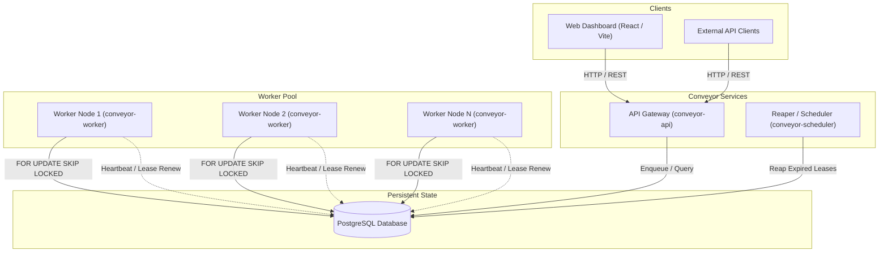

# Conveyor — Distributed Job Processing Platform

A high-performance, fault-tolerant distributed background job execution platform built with **C++17**, **PostgreSQL**, and a modern **React dashboard**. Designed for guaranteed at-least-once task delivery, automated failure recovery, exponential retry backoff, and real-time observability.

---

## Key Highlights

- **High-Throughput Concurrency:** Job claims powered by PostgreSQL `FOR UPDATE SKIP LOCKED` to prevent lock contention and eliminate race conditions across multiple worker processes.
- **Guaranteed At-Least-Once Execution:** Lease-based execution with worker heartbeats. Background scheduler reapers automatically detect unresponsive nodes and requeue abandoned jobs.
- **Fencing Protection:** Job completions (Ack/Nack) validate `(worker_id, attempts)` ownership to ensure stale zombie workers cannot corrupt retried jobs.
- **Resilient Retries & DLQ:** Exponential backoff with equal jitter prevents thundering herd issues. Exhausted jobs route to a Dead Letter Queue (DLQ) with one-click API / UI replay.
- **Idempotency Guarantee:** Deduplication via unique `idempotency_key` constraints to prevent duplicate execution of critical jobs.
- **Real-Time Web Dashboard:** Minimalist, high-performance UI for monitoring queue telemetry, active worker fleets, Dead Letter Queues, and manual task dispatching.
- **Chaos-Tested:** Integrated chaos testing suite simulating ungraceful worker termination (`kill -9`) to verify zero-job-loss guarantees.

---

## System Architecture



---

## Tech Stack

| Domain | Technology | Purpose |
| :--- | :--- | :--- |
| **Backend Engine** | C++17 | Core API gateway, worker engine, scheduler daemon |
| **Database** | PostgreSQL 16 | ACID-compliant queue store, row-level locking, JSONB payloads |
| **DB Client** | `libpq` (Native C API) | Connection pooling and high-performance parameterized queries |
| **HTTP Server** | `cpp-httplib` | Multi-threaded embedded REST server |
| **JSON Serialization**| `nlohmann/json` | Fast schema validation and JSON manipulation |
| **Frontend** | React 18, Vite, Tailwind CSS | Telemetry dashboard, job dispatcher, DLQ inspector |
| **Icons & UI** | Lucide React, Framer Motion | Interface controls and real-time state transitions |
| **Deployment** | Docker & Docker Compose | Multi-container orchestration |

---

## Quickstart

### Prerequisites
- Docker & Docker Compose installed

### 1. Launch Full Stack
Run the entire platform (PostgreSQL + API + Scheduler + 2 Workers + Web Dashboard):

```bash
cd deploy
docker compose up --build --scale worker=2
```

- **Web Dashboard:** [http://localhost:3000](http://localhost:3000)
- **REST API:** [http://localhost:8080](http://localhost:8080)
- **PostgreSQL:** `localhost:5432`

---

## REST API Reference

### 1. Enqueue Job
`POST /jobs`

```bash
curl -X POST http://localhost:8080/jobs \
  -H "Content-Type: application/json" \
  -H "Idempotency-Key: job-order-1001" \
  -d '{
    "type": "echo",
    "queue": "default",
    "priority": 10,
    "max_attempts": 3,
    "payload": {
      "message": "Process data batch #1"
    }
  }'
```

**Response (`201 Created` / `200 OK` on idempotent replay):**
```json
{
  "id": "7b5871fe-0a44-4828-98e9-dcbff859d57a",
  "queue": "default",
  "type": "echo",
  "priority": 10,
  "attempts": 0,
  "max_attempts": 3,
  "status": "queued"
}
```

### 2. Inspect Job
`GET /jobs/:id`

```bash
curl http://localhost:8080/jobs/7b5871fe-0a44-4828-98e9-dcbff859d57a
```

### 3. Queue Statistics
`GET /stats`

```bash
curl http://localhost:8080/stats
```
```json
{
  "blocked": 0,
  "queued": 4,
  "running": 2,
  "succeeded": 128,
  "dead": 1
}
```

### 4. Active Worker Fleet
`GET /workers`

```bash
curl http://localhost:8080/workers
```

### 5. Dead Letter Queue
`GET /dead`

```bash
curl http://localhost:8080/dead
```

### 6. Replay Dead Job
`POST /jobs/:id/replay`

```bash
curl -X POST http://localhost:8080/jobs/7b5871fe-0a44-4828-98e9-dcbff859d57a/replay
```

---

## Chaos & Resilience Testing

The repository includes a dedicated chaos tester that validates recovery when workers terminate abruptly mid-execution:

```bash
cd deploy
docker compose down -v
docker compose --profile chaos up -d --build --scale worker-chaos=3 api scheduler worker-chaos
docker compose --profile chaos run --rm chaos
docker compose --profile chaos logs scheduler
docker compose --profile chaos down -v
```

---

## Local Development (Frontend Standalone)

To develop or test the frontend independently:

```bash
cd frontend
npm install
npm run dev
```

The Vite dev server starts at `http://localhost:3000` and automatically proxies `/api` requests to the C++ backend on port `8080`.

---

## License

This project is licensed under the MIT License.
